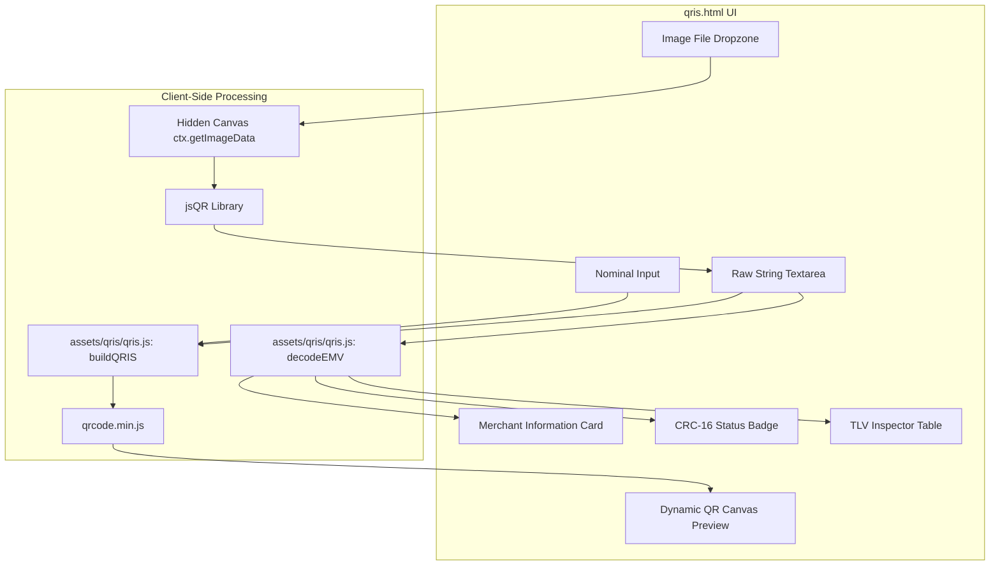

# QRIS Parser & Dynamic Generator Implementation Plan

> **For agentic workers:** REQUIRED SUB-SKILL: Use superpowers:subagent-driven-development to implement this plan task-by-task. Steps use checkbox (`- [ ]`) syntax for tracking.

**Goal:** Membangun antarmuka web client-side `qris.html` yang memungkinkan pengguna mem-parsing string QRIS atau upload gambar QR code, menampilkan rincian merchant info dan status CRC, membuat QRIS dinamis dengan nominal baru, serta menghubungkan tool ke `index.html`.

**Architecture:** Halaman mandiri `qris.html` memanfaatkan modul pure-JS `assets/qris/qris.js` dan `assets/qris/mcc.js` untuk parsing EMVCo TLV dan pembuatan QRIS ber-nominal. Pembacaan gambar dilakukan di browser via `jsQR` (canvas image data), dan visualisasi QR code dinamis di-render via `qrcode.min.js`. Semua pemrosesan berlangsung 100% lokal di browser pengguna.

**Architecture Diagram:**



**Tech Stack:** Vanilla HTML5, Vanilla CSS (Dark Theme, responsive), ES Modules JavaScript (`assets/qris/qris.js`), CDN libraries (`jsQR` v1.4.0, `qrcode` v1.5.3).

## Global Constraints

- Standar EMVCo QRIS TLV parsing harus memakai `assets/qris/qris.js`.
- Semua data diproses 100% di browser tanpa upload gambar atau data finansial ke server eksternal.
- Tema warna dan desain harus selaras dengan tool yang sudah ada (`#1e1e1e`, `#111`, border `#333`, typography modern).
- Unit test yang ada di `assets/qris/qris.test.js` harus tetap 100% passing.

---

### Task 1: Verify & Finalize QRIS Core Logic

**Files:**
- Existing: `assets/qris/qris.js`
- Test: `assets/qris/qris.test.js`

**Interfaces:**
- Consumes: `decodeEMV(payload)`, `buildQRIS(payload, amount)`, `crc16(data)`, `tagName(tag, parentTag)`, `currencyName(code)`, `mccName(code)`
- Produces: Verified core logic exports for `qris.html` import.

- [ ] **Step 1: Run core test suite**
Run: `node --test assets/qris/qris.test.js`
Expected: 24 tests PASS.

- [ ] **Step 2: Commit verified state**
```bash
git add assets/qris/
git commit -m "feat(qris): add and verify core EMVCo parser module"
```

---

### Task 2: Implement `qris.html` UI, Image Scanner, & Generator

**Files:**
- Create: `qris.html`
- Uses: `assets/qris/qris.js`, `assets/qris/mcc.js`

**Interfaces:**
- Consumes: `decodeEMV`, `buildQRIS`, `tagName`, `currencyName`, `jsQR`, `QRCode`
- Produces: Standalone responsive web application for QRIS parsing, scanning, and dynamic building.

- [ ] **Step 1: Create `qris.html` structure with Dark Theme CSS**
Build layout with:
- Back button to `/`
- Heading and subtitle
- Dual input section: Textarea + Drag-and-drop file dropzone
- Error notification container
- Merchant details card (Name, City, Postal Code, Country, NMID, MPAN, Criteria, GUID, MCC)
- Transaction status and CRC badge
- Dynamic amount modifier with nominal input, Generate button, new payload copy button, canvas preview, and Download PNG button
- Collapsible TLV inspector table

- [ ] **Step 2: Implement Image Decoding with `jsQR` and File Dropper**
- Hook dragover, dragleave, drop, and file input change events.
- Read file via `FileReader` as data URL, draw onto offscreen `<canvas>`, call `jsQR(imageData.data, width, height)`.
- If QR code found, populate textarea and trigger parse. If not found, display clear warning.

- [ ] **Step 3: Implement Live EMVCo Parsing and UI Updates**
- On textarea change/input, call `decodeEMV(payload)`.
- Fill Merchant Card and badges:
  - If CRC valid: Green badge `CRC: Valid (XXXX)`.
  - If CRC invalid: Red badge `CRC Mismatch (Stored: XXXX, Computed: YYYY)`.
- Render hierarchical TLV table showing Tag, Name, Length, Value (and sub-tags for 26-51 and 62).

- [ ] **Step 4: Implement Dynamic Amount Generator & QR Canvas Render**
- Bind "Generate QRIS Dinamis" click event.
- Call `buildQRIS(currentPayload, amount)`.
- Call `QRCode.toCanvas(canvasElement, newPayload, { width: 240, margin: 2 })`.
- Provide Copy button with animated "Tersalin!" toast and Download PNG button using `canvas.toDataURL("image/png")`.

- [ ] **Step 5: Verify in browser**
Open `qris.html` locally, test pasting sample vectors (V1_STATIC, V2_DYNAMIC), test changing amount, test image drag-and-drop.

- [ ] **Step 6: Commit `qris.html`**
```bash
git add qris.html
git commit -m "feat: implement QRIS parser and dynamic generator web page"
```

---

### Task 3: Integrate QRIS Tool into Launcher (`index.html`)

**Files:**
- Modify: `index.html`

- [ ] **Step 1: Add QRIS Tool Card to `index.html`**
Add `<a href="/qris.html">💳 QRIS Parser & Generator</a>` into the `.tools` container.

- [ ] **Step 2: Commit `index.html`**
```bash
git add index.html
git commit -m "feat: add QRIS parser to index tools list"
```

---

### Task 4: End-to-End Verification

- [ ] **Step 1: Run all automated tests**
Run: `node --test assets/qris/qris.test.js`
Expected: 24 passed.

- [ ] **Step 2: Verify git status and clean working tree**
Run: `git status`
Expected: All files committed cleanly.
