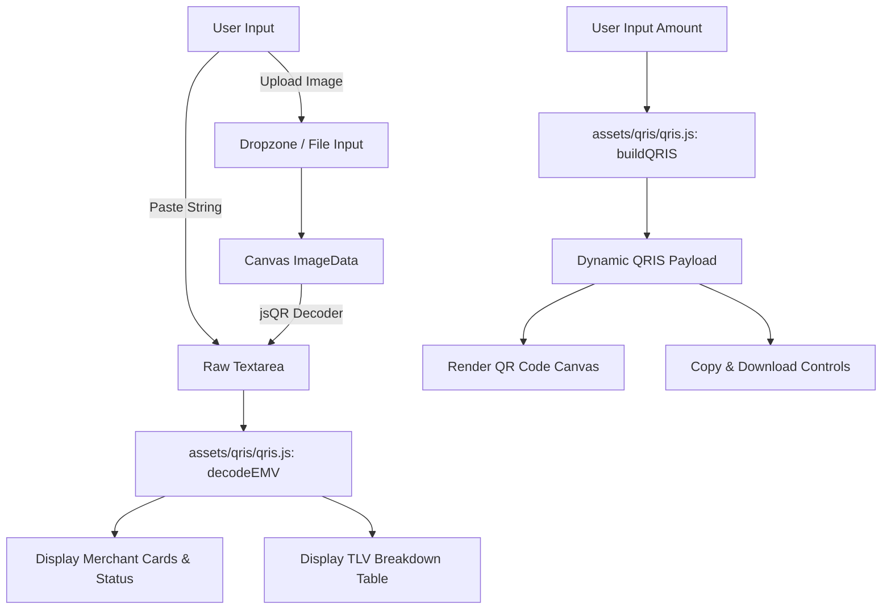

# Specification: QRIS Parser & Dynamic Generator Tool

- **Date:** 2026-10-06
- **Status:** Proposed
- **Author:** Pair Programming (User & Antigravity)

## 1. Overview & Objective
Membangun tool antarmuka web client-side (`qris.html`) untuk mem-parsing data QRIS (Quick Response Code Indonesian Standard berbasis spesifikasi EMVCo), mengekstrak serta menampilkan informasi merchant secara lengkap dan terstruktur, memeriksa integritas checksum (CRC-16), serta menyediakan fitur untuk menghasilkan QRIS dinamis dengan nominal kustom beserta visualisasi kode QR baru.

## 2. Core Requirements & Features
1. **Dual Input Mode:**
   - **Teks String:** Input textarea responsif untuk paste string QRIS raw (`000201...`).
   - **Upload / Drag & Drop Gambar:** Area dropzone untuk file gambar QR code (`.png`, `.jpg`, `.jpeg`, `.webp`), dengan pembacaan isi QR otomatis menggunakan pustaka client-side `jsQR`.
2. **Merchant Information Display:**
   - Nama Merchant (Tag 59)
   - Kota Merchant (Tag 60)
   - Kode Pos (Tag 61) & Negara (Tag 58)
   - NMID / National Merchant ID (Tag 51 atau sub-tag 03 pada Tag 26-51)
   - Kategori Merchant / MCC (Tag 52) dengan label industri yang mudah dimengerti (misal: "Restoran / Tempat Makan")
   - Tipe QRIS: Statis (01=11) vs Dinamis (01=12)
   - Merchant Account Info (Acquirer / GUID `ID.CO.QRIS.WWW`, MPAN, Kriteria Usaha `UMI`/`UME`/`UKE`/`UBE`)
   - Nominal saat ini & Mata Uang (IDR - 360)
3. **CRC-16 Integrity Check:**
   - Membandingkan CRC tersimpan (Tag 63) dengan kalkulasi `crc16` CCITT-FALSE.
   - Status visual: Badge hijau jika valid, badge merah peringatan jika checksum tidak cocok / payload rusak.
4. **Dynamic Amount Generator:**
   - Input nominal rupiah dengan format angka bersih.
   - Generate string payload dinamis menggunakan `buildQRIS` (Tag 54 dimasukkan, Tag 01 diset ke dinamis, Tag 63 dihitung ulang).
   - Render preview QR code dinamis di canvas menggunakan pustaka `qrcode.min.js`.
   - Tombol copy string QRIS baru dan tombol download gambar QR code (PNG).
5. **Technical TLV Inspector (Collapsible):**
   - Rincian tabel Tag, Length, Value, dan Tag Name (termasuk nesting level 2 untuk Tag 26-51 dan Tag 62).
6. **Launcher Integration:**
   - Menambahkan tautan tool di `index.html` dengan icon dan deskripsi ringkas.

## 3. Architecture & File Structure
Aplikasi berjalan 100% di browser pengguna tanpa dependensi backend/server, menjamin privasi penuh (gambar dan data finansial merchant tidak pernah dikirim ke server luar).

- `qris.html`: Halaman antarmuka utama (struktur semantik HTML5, dark theme CSS terintegrasi).
- `assets/qris/qris.js`: Modul parser EMVCo TLV, validator, dan payload builder yang sudah teruji (Node test suite lolos 24/24).
- `assets/qris/mcc.js`: Kamus pemetaan kode MCC (Merchant Category Code) ke deskripsi bahasa manusia.
- Pustaka pendukung eksternal (via CDN resmi/ringan):
  - `jsQR.min.js`: Untuk dekode gambar QR ke teks string di canvas.
  - `qrcode.min.js`: Untuk merender QR code canvas saat nominal diubah.
- `index.html`: Diperbarui untuk menyertakan tautan navigasi ke `/qris.html`.

## 4. User Interaction & Data Flow

## 5. UI/UX Design System
- **Theme:** Dark mode modern senada dengan estetika developer tools repo (`#1e1e1e` background, `#111` card surfaces, `#333` border line, aksen `#4f8` untuk sukses/valid dan `#f66` untuk peringatan/error).
- **Typography:** System fonts modern (`system-ui, -apple-system, sans-serif`), monospace untuk payload teks dan NMID/MPAN.
- **Responsiveness:** Tampilan responsif pada perangkat desktop maupun mobile.
- **Feedback:** Animasi transisi halus pada saat copy berhasil ("Disalin!"), drag hover effect pada dropzone gambar, dan visual badge status yang jelas.

## 6. Error Handling & Edge Cases
- **Bukan Format QRIS / TLV Rusak:** Menampilkan notifikasi error yang jelas dan memandu pengguna jika teks bukan format EMVCo standar.
- **Gambar Tanpa QR Code:** Menampilkan pesan edukatif jika foto buram atau QR code tidak terdeteksi.
- **Payload Terpotong:** Tetap menampilkan field yang berhasil dibaca namun memberi peringatan CRC Mismatch.
- **Validasi Nominal Dinamis:** Mencegah nominal <= 0 atau format desimal tidak valid.

## 7. Verification & Testing
- Unit test suite: `node --test assets/qris/qris.test.js` (24 unit tests mencakup parsing flat, nested, dynamic conversion, CRC calculation, and error cases).
- Visual and interaction testing: Membuka `qris.html` di browser, menguji scan gambar QR contoh (statis), mengonversi ke nominal dinamis, dan memverifikasi QR code yang dihasilkan dapat dipindai ulang.
